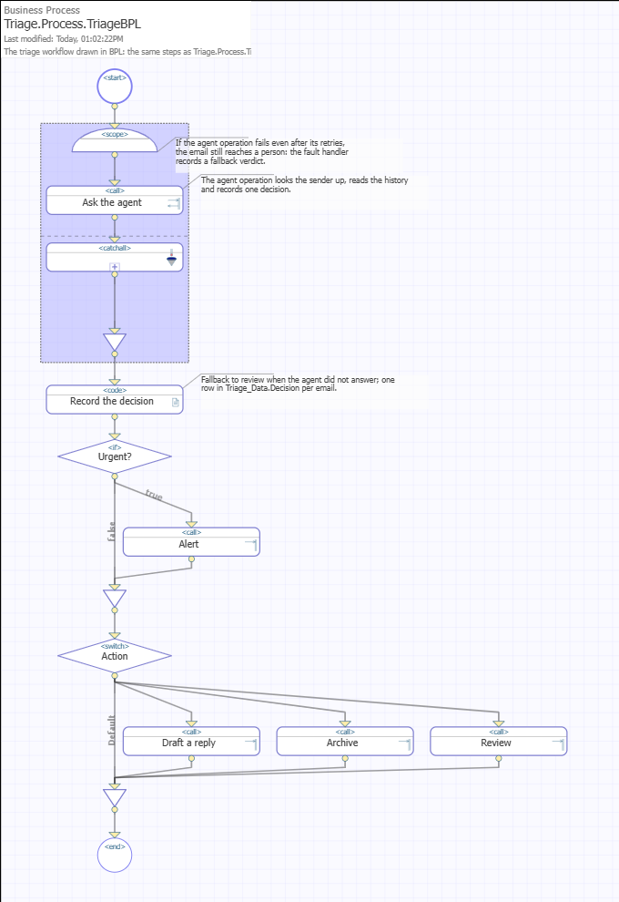
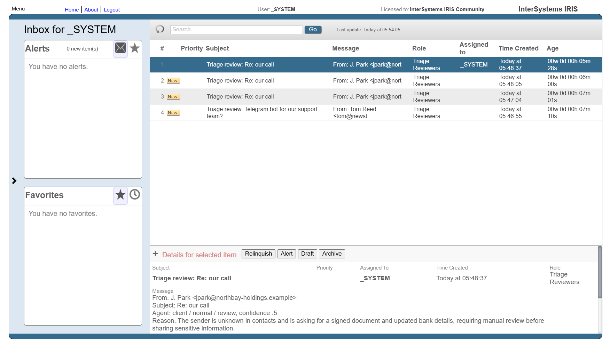
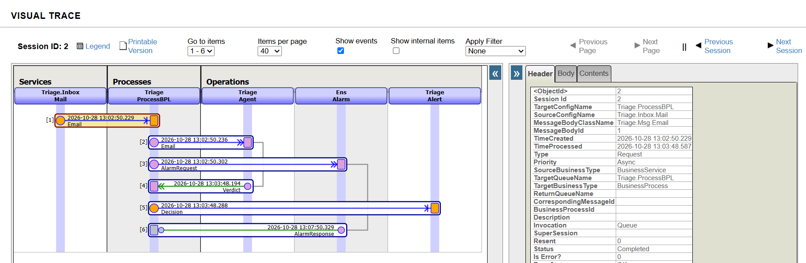

# Inbox triage with an IRIS AI Hub agent


An InterSystems IRIS Interoperability production that reads a mailbox, asks an AI Hub agent what each message needs, and acts on the answer: an alert for urgent mail, a draft reply for a quick question, the archive, or a task for a person in the Workflow Inbox when the agent is unsure. What the person decides becomes a precedent in an IRIS Vector Search knowledge base, and the agent decides the next email like it the same way. Every decision, every tool call the agent made and every draft is a row in IRIS, and every step is a message in the production's trace.

It is modeled on the inbox monitor I run for my own freelance work, where pitches to editors, client threads, hosting notices and newsletters land in one mailbox and the urgent ones must not wait. Built for the InterSystems "AI Agents in Interoperability Workflows" contest on the AI Hub Early Access build.

## How it works

```
 mailbox (IMAP) ──► Triage.Inbox.IMAP ────► Triage.ProcessBPL ─┐
                                                                │   sync    ┌─────────────────────────────┐
 .eml files ────► Triage.Inbox.Folder ───► Triage.Process ─────┼──────────► Triage.Agent                  │
                                              (ObjectScript)    │           │ %AI.Agent "Classifier"      │
                                                                │  Verdict  │  LookupContact   (SQL tool) │
                   Triage_Data.Decision ◄───────────────────────┘           │  SenderHistory   (SQL tool) │
                              │                                             │  search_precedents (vector) │
                              │                                             │  RecordDecision             │
            ┌─────────────────┼──────────────────┬─────────────────┐        │ policies: one decision,     │
            ▼                 ▼                  ▼                 ▼        │           audit every call  │
      Triage.Alert      Triage.Review      Triage.Draft      Triage.Archive └─────────────────────────────┘
      Triage_Data.Alert Workflow task      %AI.Agent "Writer"  status=archived
      + webhook         for a person:      Triage_Data.Draft
                        Alert, Draft or    + mail to the owner
                        Archive, routed
                        like the agent's
```

1. **Three ways in.** `Triage.Inbox.IMAP` is a Business Service on `Triage.Adapter.IMAPInbound`, a custom inbound adapter written in Embedded Python, because IRIS ships a POP3 adapter only. Python's `imaplib` fetches unseen messages without flagging them, and `python/triage_mail.py` decodes each one with the `email` package: nested multiparts, quoted-printable and base64 bodies, charsets, encoded-word headers. Each email becomes a `Triage.Msg.Email` with the sender, the subject, the plain text of the body (an HTML-only message is reduced to text) and the number of attachments. A message is flagged `\Seen` only after the service accepted it; one that was accepted but not flagged (the connection dropped) is remembered by UID, so it is not triaged twice. `Triage.Inbox.Mail` is the POP3 alternative on `EnsLib.EMail.InboundAdapter` (`MAIL_PROTOCOL=pop3`), with `Triage.Util.Mail` turning each `%Net.MailMessage` into the same request. `Triage.Inbox.Folder` does the same for `.eml` files dropped into `/data/inbox/`, for offline runs and tests.
2. **Two equivalent processes.** `Triage.Process.TriageBPL` is the workflow in BPL, so the diagram in the Management Portal is the documentation: call the agent, record the decision, branch. `Triage.Process.Triage` is the same workflow in ObjectScript. The mail service targets the BPL process, the folder service the ObjectScript one; both can be re-pointed in the portal.

   
3. **The agent is a Business Operation.** `Triage.Agent` (`Triage.Operation.Agent`) hosts `Triage.Agent.Classifier`, a declarative `%AI.Agent`: provider `gemini`, model `gemini-3.5-flash-lite`, key from the `GEMINI_API_KEY` environment variable, instructions in the class. Its toolset `Triage.Agent.Tools` gives it two read-only SQL tools, `LookupContact` (known clients, editors, platforms) and `SenderHistory` (earlier decisions for the same domain), and `RecordDecision`, which validates the category, urgency and action. A third lookup, `search_precedents`, comes from an AI Hub knowledge base on IRIS Vector Search (point 8). The operation returns a `Triage.Msg.Verdict` with the decision, the reason, the confidence and the session statistics (tool calls, tokens, LLM time), so each agent run is a request and a response in the message trace.
4. **Two policies travel with the toolset.** `Triage.Policy.OneDecision` (`%AI.Policy.Authorization`) lets `RecordDecision` run once per email even if the model tries again. `Triage.Policy.Audit` (`%AI.Policy.Audit`) writes every tool call, with its arguments, result, duration and outcome, to `Triage_Data.ToolCall`, tagged with the email it was made for.
5. **Failures are the operation's job.** A rate limit, a timeout or a server error from the LLM provider is retried by the operation itself (`RetryInterval` 20 s, `FailureTimeout` 180 s). If the agent still fails, or records nothing, the process falls back to a `review` verdict: the email reaches a person instead of being dropped. In BPL this is a fault handler around the call.
6. **Three operations act on the decision.** `Triage.Alert` stores urgent mail in `Triage_Data.Alert` and can post it to a webhook. `Triage.Draft` runs a second agent, `Triage.Agent.Writer`, that writes a short reply, stores it in `Triage_Data.Draft` and mails it to the owner's mailbox through `EnsLib.EMail.OutboundAdapter`, ready to edit and send. `Triage.Archive` closes the decision.
7. **A person decides what the agent could not, on the Workflow Engine.** An email the agent marks `review`, or decides with confidence below 0.6, goes to `Triage.Review`, a BPL process (`Triage.Process.ReviewBPL`) that sends an `EnsLib.Workflow.TaskRequest` to the `Triage Reviewers` role (`EnsLib.Workflow.Operation`). The task shows up in the Workflow Inbox of every member of the role (`_SYSTEM` in the demo) with the agent's verdict, its reason and the start of the email. The reviewer accepts it and picks **Alert**, **Draft** or **Archive**; the process records who decided what (`ReviewedBy`, `ReviewAction`, `ReviewedAt`, next to the agent's own `Action`) and routes the email to that operation, so a draft the person asks for is written by the same writer agent. The classifier is told to hand over an unknown sender who claims an earlier conversation or asks the owner to pay, send bank details, sign or log in.

   
8. **A person's decision becomes a precedent (IRIS Vector Search).** `Triage.Agent.Precedents` is an AI Hub knowledge base, `%AI.RAG.KnowledgeBase` over `%AI.RAG.VectorStore.IRIS`: the table `Triage_Data.Precedent` with 384-dimension vectors from the FastEmbed model that ships with AI Hub, so no embedding key or download is needed. The agent operation opens it once, gives the agent its `search_precedents` tool, and indexes every email the agent decides together with the decision. When a person decides an email in the Workflow Inbox, `Triage.Review` sends the decision back to `Triage.Agent`, which re-indexes that email as "Decided by a person in review". The classifier's first rule is to follow such a precedent. In the test run below, the follow-up from a stranger went to review; after it was archived in the Workflow Inbox, the same email sent twice more was archived by the agent with confidence 0.95, and its reason cited the person's decision.

## Tracing the agent with Interoperability

This app implements the Community Opportunity idea [DPI-I-689, "Use InterSystems Interoperability as a Traceability tool for GenAI LLM pipelines"](https://ideas.intersystems.com/ideas/DPI-I-689): the production records, in IRIS, what an LLM observability tool such as Langfuse records, for a pipeline that uses IRIS Vector Search.

| What a tracing tool records | Where it is here |
| --- | --- |
| One trace per request | The message trace of each email: service, process, the agent's request and verdict, the operation that acted, and for a review the Workflow task and the reviewer's routing (**Interoperability → View → Messages**, Visual Trace) |
| Model, prompt version, tokens, latency | Each `Triage.Msg.Verdict`: `Model`, `PromptVersion` (CRC-32 of the agent's instructions, so a decision can be tied to the prompt that made it), prompt and completion tokens, LLM time and tool-call count from the AI Hub session statistics; also on the decision row |
| Tool spans, retrieval included | `Triage_Data.ToolCall`: every tool call with its arguments, a preview of the result, the duration and the outcome, tagged with the email. The vector search is one of them, with the query the agent wrote and the scored precedents it got back |
| Errors and retries | Provider errors and the operation's retries in the Event Log; the fallback verdict in the trace when the agent did not answer |
| Human feedback on outputs | The reviewer's action next to the agent's on the same row (`ReviewedBy`, `ReviewAction`, `Action`), and the re-indexed precedent that feeds it back into the next decision |

Because it is all SQL in the same namespace, the questions are queries, joined with the business data:

```sql
-- What reviewers decided, by prompt version and by what the agent had proposed
SELECT PromptVersion, Action AS AgentAction, ReviewAction, COUNT(*) AS Emails
FROM Triage_Data.Decision WHERE ReviewAction IS NOT NULL GROUP BY PromptVersion, Action, ReviewAction

-- Tokens, LLM time and tool calls per action the agent chose
SELECT Action, COUNT(*) AS Verdicts, AVG(PromptTokens) AS PromptTokens, AVG(LlmMs) AS LlmMs, AVG(ToolCalls) AS ToolCalls
FROM Triage_Msg.Verdict GROUP BY Action

-- What the vector search returned for one email
SELECT Arguments, Result, DurationMs FROM Triage_Data.ToolCall WHERE ToolName = 'search_precedents' AND MessageId = ?
```

What it does not do: there is no prompt playground or prompt editor, cost is in tokens rather than money, and the full prompt sent to the model is not stored, only the email it was built from and the instructions' version.

## Run it

Requirements: Docker, the IRIS Community image with AI Hub from the [Early Access Program portal](https://evaluation.intersystems.com/Eval/early-access/AIHub) (file `iris-community-2026.3.0AI.154.0-docker.tar.gz`), and a Gemini API key from [Google AI Studio](https://aistudio.google.com/apikey); the free tier is enough.

```sh
docker load -i iris-community-2026.3.0AI.154.0-docker.tar.gz
git clone https://github.com/works-on-my-box/iris-inbox-triage.git
cd iris-inbox-triage
cp .env.example .env                # put your GEMINI_API_KEY here
docker compose up -d --build        # IRIS with the production, plus a test mail server (GreenMail)
scripts/demo.sh                     # sends the eight samples over SMTP, waits for the agent, prints the results
```

`scripts/send.sh data/samples/*.eml` only submits the samples; the production picks them up over IMAP within seconds.

The build installs IPM and loads the module with `zpm "load"`; the production starts with IRIS. A minute or two after sending, the samples are decided. Where to look, in the Management Portal at http://localhost:52773/csp/sys/UtilHome.csp (user `_SYSTEM`, password `SYS`):

- **Interoperability → View → Messages**: open any `Triage.Msg.Email` and its trace: the agent's request, its verdict with the reason and statistics, and the operation that acted on it.

  
- **Workflow Inbox** at http://localhost:52773/csp/user/_DeepSee.UserPortal.Workflow.zen (the Analytics User Portal; the setup enables Analytics for `/csp/user`): the review task for the unclear email. Click it, **Accept**, then **Alert**, **Draft** or **Archive**. From the command line, `scripts/review.sh` lists the open tasks and `scripts/review.sh Archive` completes them the same way.
- **Interoperability → Build → Business Processes → Triage.Process.TriageBPL**: the workflow diagram.
- **Interoperability → Configure → Production**: the running production; the IMAP service shows the server and the mailbox it polls.
- **System Explorer → SQL**:

```sql
SELECT Sender, Category, Urgency, Action, Confidence, Status, ReviewedBy, ReviewAction, Reason FROM Triage_Data.Decision
SELECT MessageId, ToolName, Arguments, DurationMs, Success FROM Triage_Data.ToolCall
SELECT Recipient, Subject, Status, Body FROM Triage_Data.Draft
```

The drafts also arrive in the owner's mailbox on the test server: `owner@triage.local`, password `owner`, POP3 on `localhost:3110` or IMAP on `localhost:3143`.

Unit tests (mail parsing in ObjectScript and in Embedded Python, tool validation, policies, the decision record, the review step, retry rule) run inside the container:

```sh
scripts/test.sh
```

Without the mail server, `scripts/drop.sh data/samples/*.eml` feeds the folder service instead.

## Configuration

A real mailbox instead of the test server: set these in `.env` and restart with `docker compose up -d`. Gmail works over IMAP with an app password (`MAIL_HOST=imap.gmail.com`, `MAIL_TLS=1`); triaged messages are marked as read.

| Variable | Meaning |
| --- | --- |
| `MAIL_PROTOCOL` | `imap` (default) or `pop3`: which service reads the mailbox; POP3 deletes each message after reading it |
| `MAIL_HOST`, `MAIL_TLS=1` | Mail server the production polls; with TLS the ports default to 993 (IMAP) and 995 (POP3) |
| `MAIL_IMAP_PORT`, `MAIL_POP3_PORT` | Other ports, if needed |
| `MAIL_USER`, `MAIL_PASSWORD` | Mailbox credentials (stored as the `TriageMail` credentials in IRIS) |
| `MAIL_SMTP_HOST`, `MAIL_SMTP_PORT` | SMTP server for the drafts, same credentials |
| `DRAFTS_TO` | Mailbox that receives the drafts (default: `MAIL_USER`) |

`Triage.Setup.Configure` runs when the container starts (`after-start.sh`) and applies the values as system default settings of the production, including which inbox service is enabled, so the production definition in the repository stays unchanged. The test server has mailboxes `triage@triage.local` (the one the production reads) and `owner@triage.local`, password = login.

To use another provider, change `PROVIDER`, `MODEL` and `APIKEY` in `Triage.Agent.Classifier` and `Triage.Agent.Writer`; AI Hub also supports OpenAI, Anthropic, Vertex AI, Bedrock, OpenRouter, xAI and OpenAI-compatible local servers.

## Project layout

```
src/cls/Triage/
  Production.cls            the production: 3 services, 3 processes, 5 operations (one of them the Workflow role)
  Adapter/IMAPInbound.cls   custom inbound adapter: IMAP in Embedded Python (imaplib), flag after processing
  Service/IMAPInbox.cls     IMAP mailbox -> Triage.Msg.Email
  Service/MailInbox.cls     POP3 mailbox -> Triage.Msg.Email (MAIL_PROTOCOL=pop3)
  Service/FileInbox.cls     .eml folder  -> Triage.Msg.Email
  Util/Mail.cls             %Net.MailMessage or decoded IMAP mail to Triage.Msg.Email: parts, HTML, attachments
  Process/TriageBPL.cls     the workflow in BPL (fault handler, switch on the action)
  Process/Triage.cls        the same workflow in ObjectScript
  Process/ReviewBPL.cls     review by a person: Workflow task, the reviewer's choice recorded and routed
  Operation/Agent.cls       hosts the classifier agent; retries transient provider errors
  Operation/Draft.cls       writer agent + SMTP adapter; Triage_Data.Draft
  Operation/Alert.cls       Triage_Data.Alert, optional webhook
  Operation/Archive.cls     closes the decision
  Agent/Classifier.cls      %AI.Agent: instructions, provider, model, toolset
  Agent/Tools.cls           %AI.ToolSet: two SQL queries, RecordDecision, the policies
  Agent/Writer.cls          %AI.Agent that writes the draft reply
  Agent/Precedents.cls      AI Hub knowledge base on IRIS Vector Search: search_precedents, re-indexed after review
  Policy/OneDecision.cls    %AI.Policy.Authorization: RecordDecision once per email
  Policy/Audit.cls          %AI.Policy.Audit: every tool call -> Triage_Data.ToolCall
  Msg/                      Email (request), Verdict (agent response), Decision (to the operations)
  Data/                     Decision, Contact, Alert, Draft, ToolCall tables
  Setup.cls                 demo contacts, the reviewer role; runtime configuration from the environment
python/triage_mail.py       MIME decoding with Python's email package; IPM copies it to the IRIS python directory
tests/Triage/Test/          %UnitTest cases, run by scripts/test.sh
data/samples/               nine made-up emails: HTML-only mail, a PDF attachment, one that needs a person
scripts/                    demo.sh (the whole run), send.sh, drop.sh, review.sh (the review queue), test.sh
module.xml                  IPM module; Dockerfile, iris.script, after-start.sh, docker-compose.yml
```

## Sample run

The nine sample emails and the four known contacts are made up. One run on October 30, 2026, after a clean build, mail read over IMAP, all nine decided by the agent with three tool calls each:

| Email | Category | Urgency | Action |
| --- | --- | --- | --- |
| An editor commissions a pitched article and asks for a date | editorial | hot | alert |
| A known client asks to extend a scraper before Black Friday | client | hot | alert |
| The hosting provider says a payment failed | platform | hot | alert |
| A weekly JavaScript newsletter | newsletter | low | archive |
| An SEO spam offer | spam | low | archive |
| A stranger asks whether I build Telegram bots | client | normal | draft_reply |
| A known client asks a quick question (HTML-only mail) | client | normal | draft_reply |
| The hosting provider sends an invoice as a PDF attachment | platform | low | archive |
| A stranger refers to "our call" and asks for a signed document and bank details | other | normal | review (confidence 0.5) |

The last one became a task in the Workflow Inbox; completing it there with **Archive** closed the decision as `archived` with `ReviewedBy = _SYSTEM`, and with **Draft** the writer agent drafted a reply. Model output varies between runs, and the instructions in `Triage.Agent.Classifier` name the action for each case to keep it steady. The reason stored with each decision shows what the agent relied on, and `Triage_Data.ToolCall` shows what it looked up. The two drafts were mailed to `owner@triage.local`; the one for the quick question says the schedule has to be checked rather than inventing an answer.

## Notes from building it on the Early Access build (2026.3.0AI.154.0)

- A ToolSet with `<Query>` tools does not compile in the same load as the tables it queries unless the ToolSet class declares `DependsOn` on them: the SQL is validated at compile time, and the table exists only after its class is compiled. `Triage.Agent.Tools` has `DependsOn = (Triage.Data.Contact, Triage.Data.Decision, ...)`.
- Policies declared in the toolset's `<Policies>` block must not carry child elements: the compiler copies a child element of one policy (for example `<PreviewChars>` under `<Audit>`) into the generated code of every policy, and the agent then fails at start with `<PROPERTY DOES NOT EXIST>`. Defaults live in the policy classes instead.
- `%AI.Policy.Audit.%LogExecution` has to be declared `As %Status`, although the guide shows it without a return type.
- Free-tier Gemini returns HTTP 429 after about twenty calls in a minute; with three tool calls per email that is a handful of emails. Letting the Business Operation retry (`Retry` plus `RetryInterval` and `FailureTimeout`) handles it without any code in the agent, and the retries are visible in the event log.
- IRIS has a POP3 adapter but no IMAP one (and no `%Net.IMAP` class), so the IMAP adapter is written in Embedded Python. The raw message, attachments included, is decoded in Python and only the fields cross into ObjectScript: a large message passed as one string would hit the 3.6 MB string limit. IPM installs `python/triage_mail.py` into `mgr/python` with a `FileCopy` resource; that directory is on Embedded Python's `sys.path`.
- The Workflow Inbox lives in the Analytics User Portal, `_DeepSee.UserPortal.Workflow.zen`; with Analytics disabled for the web application it answers "Invalid action". **Interoperability → Manage → Workflow → Workflow Worklist** lists the tasks but has no buttons to act on them. `Triage.Setup` enables Analytics for `/csp/user`.
- In this build `%AI.RAG.Embedding.FastEmbed.EmbedBatch()` answers "use the Rust bridge directly", so the bundled embedding model is reachable only through `%AI.RAG.KnowledgeBase` (indexing and its search tool), not from ObjectScript. The knowledge base splits text into chunks of a few hundred characters, so each precedent starts with its decision and keeps the email short: otherwise the chunk a search returns may not say what was decided.
- A knowledge-base tool added with `AddToAgent()` is not covered by the policies declared in the toolset. The agent's tool manager takes an audit policy of its own (`SetAuditPolicy`), but that one sees the toolset's tools too, and they were logged twice; the copy attached there logs only `search_` tools (`Triage.Policy.Audit.ToolPrefix`).
- An agent that can read its own earlier decisions can take them for evidence. In testing, an unknown sender who claimed an earlier call and asked for bank details was first classified as a client thread; the next email from the same domain was then decided with the reason "prior history as a client", citing that first decision. The instructions now say that only `LookupContact` makes a sender known, and such an email goes to a person.
- `EnsLib.EMail.InboundAdapter` skips a message on later polls once the service returned an error for it. The mail service therefore never returns an error: a message it cannot parse still goes to the process with what could be read, and ends up in review.

## Author

Oleg Naryzhnykh ([Developer Community profile](https://community.intersystems.com/user/oleg-naryzhnykh), [GitHub](https://github.com/works-on-my-box)). MIT license, see [LICENSE](LICENSE).
